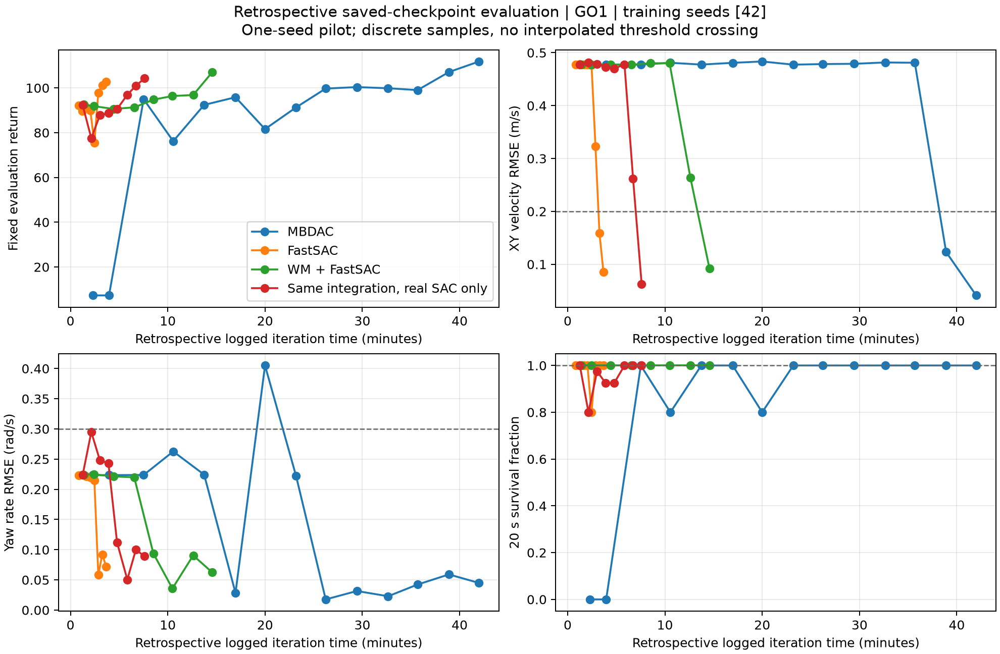
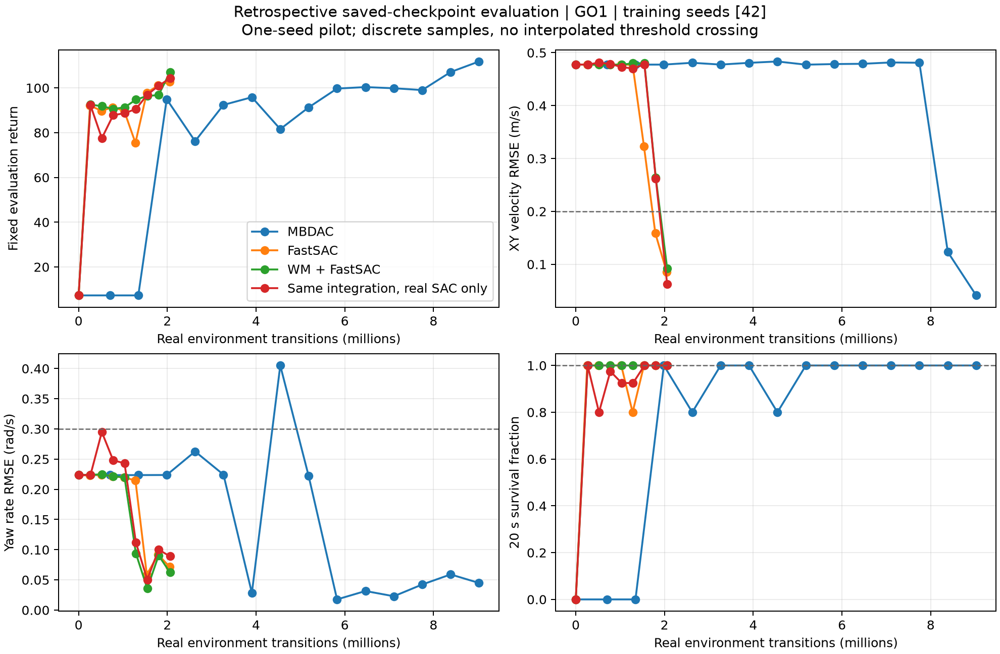

# rl_algs

Simulator-independent PyTorch reinforcement learning, installed as the **`mbdac`**
Python package. The runner follows RSL-RL conventions. Training uses a learned,
differentiable world model; the physical simulator supplies real transitions
and does not need to support gradients.

| Algorithm | Python configuration | Learning rule |
| --- | --- | --- |
| **MBDAC** | `MBDAC` | Short imagined rollouts, analytic policy gradients and a bootstrapped value critic |
| **MBDACAMP** | `MBDACAMP` | MBDAC plus an adversarial motion prior trained from policy/expert transitions |
| **WM+FastSAC** | `MBDACFastSAC` | Real-data distributional Q/temperature updates plus configurable real SAC/model actor gradients |
| **FastSAC** | Native example: `--method fastsac` | Original source learner used as the external comparison baseline |

[Installation](#installation) · [Usage](#usage) · [Performance](#performance) ·
[Method and code sources](#method-and-code-sources)

## Method and code sources

**MBDAC is this package's name for its model-based differentiable actor–critic.**
Its immediate method reference is [SuperMimic](https://arxiv.org/pdf/2610.28480),
§§3.1–3.3 and Appendix D: fit dynamics from real simulator transitions, then
improve the policy through short model rollouts with a terminal value estimate.
SuperMimic explicitly traces its short-horizon, critic-bootstrapped objective to
[SHAC — Accelerated Policy Learning with Parallel Differentiable Simulation](https://arxiv.org/abs/2204.07137)
(ICLR 2022). It uses learned dynamics for derivatives, soft survival weights and
no EMA target value critic. Its replay-seeded imagination also follows the
Dyna-style learning pattern. This package follows that method family; it does
not require SHAC's differentiable physical simulator.

The direct initial **code** source is the MIT-licensed, unofficial
[supermimic_vibed reproduction](https://github.com/zita-ch/supermimic_vibed/tree/a1508d42c9d1699a52e8233ab16d08c488441ab9),
pinned at `a1508d42c9d1699a52e8233ab16d08c488441ab9`, refactored into this
package. This is an independent implementation, not an official SuperMimic release.

- **MBDACAMP** and **WM+FastSAC** are this package's extensions. The motion-prior
  concept comes from [AMP](https://arxiv.org/abs/2104.02180). The optional matched
  AMP velocity adapter reuses the pinned
  [AMP_mjlab](https://github.com/ccrpRepo/AMP_mjlab/tree/6c7a2947fccc973e4af8e6d90e550400f1b6fcfc)
  implementation and its RSL fork.
- **FastSAC implementation source:** [Holosoma](https://github.com/amazon-far/holosoma),
  pinned at `d18d6cc50f872c15e904a22ceac22313cec955c8`. The core includes its
  unchanged actor/Q/C51 numerical modules and normalization class with
  Apache-2.0 attribution. The separate baseline calls its original learning loop.
  The algorithm display name is **FastSAC**; it is distinct from the separate
  FlashSAC paper implementation.
- **Interface reference:** [RSL-RL](https://github.com/leggedrobotics/rsl_rl),
  public 5.x runner and TensorDict conventions.

Exact reuse, modifications and license notices are recorded in
[PROVENANCE](licenses/PROVENANCE.md) and [licenses/](licenses/).

## Installation

Clone this repository and run examples from its root:

```bash
git clone https://github.com/chengh-wang/rl_algs.git
cd rl_algs
```

### Core package

With Python ≥3.10 and an existing Python environment:

```bash
python -m pip install .
# Optional W&B support:
python -m pip install '.[wandb]'
```

The core depends on PyTorch, NumPy, TensorDict and TensorBoard. Simulator SDKs
are optional. Examples and robot/data preparation scripts live in the source
checkout; the wheel contains the learning core. The package has not been
published to PyPI, so install from this checkout or a supplied wheel.

### Tested MJLab environment

The tested setup is Linux, Python 3.11, PyTorch 2.10 with CUDA 12.8 runtime wheels,
MJLab 1.2.0 and an NVIDIA GPU. A working NVIDIA driver is required; these Python
packages supply the CUDA runtime. Headless video rendering also needs EGL/OpenGL
libraries; the comparison-video utility needs `ffmpeg` on `PATH`.

Install [uv](https://docs.astral.sh/uv/getting-started/installation/) if needed,
then create the isolated environment:

```bash
uv venv --python 3.11 .venv
uv pip install --python .venv/bin/python -r requirements-native-velocity.lock.txt
uv pip install --python .venv/bin/python --no-deps -e .
```

This lock is the tested Linux dependency snapshot, including W&B and test tools.
For other platforms, resolve the extras with `pip install '.[mjlab,wandb,dev]'`.
Native Go1/G1 velocity tasks use MJLab's bundled models and need no motion download.

## Usage

### Native MJLab velocity tracking

```bash
.venv/bin/wandb login
.venv/bin/python -m examples.mjlab_velocity.train \
  --robot go1 --method wm_fastsac --recipe hybrid \
  --num-envs 1024 --iterations 100000 --max-train-seconds 3600 \
  --compile --logger wandb --log-dir logs/my_go1_wm_fastsac
```

Use `--robot g1` for the native G1 task. Use `--logger tensorboard` to run without
W&B login. Choose a new log directory for each run. The velocity benchmark can
stop earlier after its declared stable acceptance rule or at its time budget;
`--iterations` is an upper limit, not a quality guarantee.

| Requested run | Arguments |
| --- | --- |
| MBDAC | `--method mbdac` |
| WM+FastSAC hybrid | `--method wm_fastsac --recipe hybrid` |
| Matching real-only control | `--method wm_fastsac --recipe real_only` |
| FastSAC baseline | `--method fastsac` |

**Only the original FastSAC baseline** needs the external source learner setup:

```bash
bash scripts/setup_native_velocity_baseline.sh
```

WM+FastSAC uses the numerical modules already in the package. The baseline setup
reuses the installed Torch/MJLab environment and pins its external source.
For the full sequential experiment, follow the
[benchmark protocol](doc/native_velocity_benchmark.md).

### G1 motion tracking and AMP

Prepare the G1 LAFAN1 reference library and robot assets, then choose the learner:

```bash
.venv/bin/python scripts/fetch_g1_data.py
.venv/bin/python -m examples.mjlab_g1.train \
  --algorithm MBDACAMP --num-envs 1024 --iterations 5000 \
  --compile --logger wandb --log-dir logs/my_g1_tracking_amp
```

Use `--algorithm MBDAC` for motion tracking without AMP. The download script
fetches pinned assets, retains notices and records hashes; motion data is not
redistributed in this repository. The native velocity CLI above has no AMP mode.
The separate AMP velocity example uses an isolated environment and the upstream
fork; see [AMP velocity setup](doc/velocity_benchmark.md). Detailed G1 WM+FastSAC
commands, warm-start lineage and measured outcomes are retained in the
[implementation recipes](doc/implementation_recipes_2026-10-24.md).

### RSL-style Python interface

Given an environment implementing the [model adapter contract](doc/task_contract.md):

```python
from mbdac.runners import ModelBasedRunner

cfg = {
    "algorithm": {"class_name": "MBDAC"},  # MBDAC / MBDACAMP / MBDACFastSAC
    "logger": "tensorboard",
}
runner = ModelBasedRunner(env, cfg, log_dir="logs/my_task", device="cuda:0")
try:
    runner.learn(num_learning_iterations=2000)
    runner.save("logs/my_task/checkpoint.pt")
    runner.load("logs/my_task/checkpoint.pt")
    policy = runner.get_inference_policy(device="cuda:0")
    runner.export_jit("logs/my_task/policy.pt")
finally:
    runner.close()
```

The environment provides observations/goals, physical state, applied actions,
pre-reset successors and task formulas. Missing physical measurements can be
learned as reusable primitive heads; weighted reward totals are not learned.
AMP additionally needs expert features. See the
[general task interface](doc/general_task_interface.md).
During inference call `policy.reset(dones)` at episode boundaries. Exported
policies take `(observation_history, goal)` and run with PyTorch alone.

## Performance

**Go1 flat velocity tracking, 1024 native MJLab environments, RTX 4070 Laptop
8 GB, seed 42.** Each run starts with fresh weights, replay and normalization.
The native physics/rewards/commands and physical evaluation protocol are shared;
algorithm recipes and integration differences are documented in the
[full results](doc/native_velocity_results.md).

Each evaluation uses five commands × eight nominal repeatability copies, 20 s
without resets. Acceptance requires XY RMSE ≤0.20 m/s, yaw RMSE ≤0.30 rad/s and
survival 1.0, with both errors also passing separately for every command.

**Time comparison.** Saved checkpoints were evaluated retrospectively to give
denser measurements. The horizontal axis is their original logged process time,
including earlier online evaluations. It estimates when the checkpoint was
available, rather than when its later post-hoc evaluation finished.



**Sample comparison.** The horizontal axis counts real environment transitions;
it does not equate algorithm iterations or count imagined transitions as real data.



| Method | First passing saved checkpoint: logged time | Real transitions | First online evaluation result available |
| --- | ---: | ---: | ---: |
| FastSAC | 3.679 min | 2,049,024 | 5.51 min |
| MBDAC | 41.993 min | 9,025,536 | 42.41 min |
| WM+FastSAC | 14.573 min | 2,059,264 | 15.92 min |
| Matching real-only control | 7.603 min | 2,059,264 | 10.69 min |

This single-seed pilot shows WM+FastSAC reaching acceptance earlier than MBDAC,
but **no demonstrated wall-time or sample-efficiency advantage over FastSAC or
the real-only control**. The three SAC routes use approximately the same real
samples at the saved-checkpoint resolution. Curves join discrete measurements;
no exact crossing time, monotonic learning or statistical superiority is inferred.
Compilation caches were reused while learned states started fresh.
G1 is also tested: aggregate errors pass, but forward XY RMSE is 0.213 m/s,
slightly above 0.20; it does not pass every command within its fixed budget.

[Plot data](doc/assets/native_velocity_evaluations.csv) ·
[Plot provenance](doc/assets/native_velocity_plot_provenance.json) ·
[Full report and retained development costs](doc/native_velocity_results.md) ·
[W&B curves, videos and evidence](https://forge.coreweave.com/wandb/sslab_motion_mimic-teams/mbdac-native-velocity/runs/8490af7a)

## Validation and implementation details

Final native-environment suite: **54 passed, 1 optional AMP-fork module skipped**.
The installed SDK-free wheel suite has **50 passed, 5 optional-dependency skips**.
Tests cover frozen model/Q input gradients, real-only WM fitting, reset-safe
transitions, checkpoint behavior and upstream numerical equivalence.

- [Task and adapter contract](doc/task_contract.md)
- [Physical primitive heads](doc/general_task_interface.md)
- [MBDAC audit and optimizations](doc/mbdac_audit_2026-10-24.md)
- [WM/actor/critic update schedules](doc/update_schedule_audit.md)
- [FastSAC implementation and historical recipes](doc/implementation_recipes_2026-10-24.md)
- [Licenses and source provenance](licenses/PROVENANCE.md)
