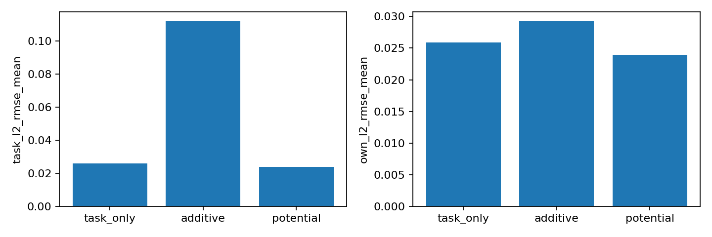

# Precision reward framework: diagnostic results

This is a simulator-free analytic counterexample and a numerical verification
of the public FlashSAC reward-provider path. It is not a robot benchmark.
See [the objective and API guide](precision_rewards.md) for the equations,
assumptions and integration contract.

## Frozen protocol

- Seeds: 42 and 43, each with task-only, additive-prior and potential modes.
- Each run: 5,000 vector steps, 128 environments, **640,000 real transitions**
  and **4,969 actual learner updates**. No imagined transitions.
- Same goal stream within a seed, generated by an isolated CPU RNG; per-seed
  stream hashes are saved. No evaluation-based checkpoint selection or tuning.
- Actual `mbdac.runners.FlashSACRunner`, CUDA, `torch.compile` default mode and
  AMP on an RTX 3090, PyTorch 2.10.0+cu128 and Python 3.11.15. Fixed reward
  divisor 1, gamma .99, C51 support [-5,5]/101 atoms,
  initial temperature .001 and target sigma .05.
- Evaluation: frozen 41x41 goal grid on [-.3,.3]^2, 1,681 points, exact grid
  points excluded from training draws. This measures interpolation, not
  extrapolation. The grid gives boundaries more weight than continuous uniform
  sampling. These are normalized coordinates, not metres.
- Task reward `-||a-g||²`; bounded adversarial prior `(a_x+1)/2`, weight .4.
  Deterministic task optimum is `a=g`; additive reward optimum is
  `(g_x+.1,g_y)`. These optima exclude the learner's entropy regularization.
- Potential mode uses initial Phi=.2 and terminal Phi=0: reward is task-.2.
  This tests objective preservation and the terminal/provider path; it does
  not demonstrate a benefit from exploratory shaping.

The config and grid were written before training. Validation guards and extra
logging were finalized while this run was in progress; those edits did not
change the benchmark's action, reward, forward, loss or optimizer equations.

## Results

RMSE here means `sqrt(mean(||action-optimum||²))`, not per-axis RMSE. Both
references are reported because each answers a different question.

| Mode | Task RMSE seed 42 | Task RMSE seed 43 | Mean task RMSE | Mean own-objective RMSE | Mean x bias from task target |
| --- | ---: | ---: | ---: | ---: | ---: |
| Task-only | .020969 | .030825 | **.025897** | .025897 | -.004839 |
| Additive prior | .094743 | .128949 | **.111846** | .029239 | +.109556 |
| Potential difference | .017855 | .030058 | **.023957** | .023957 | -.005619 |

The additive policy approximately learns its displaced reward optimum, with
x bias close to the analytic +.1 prediction. Potential shaping does not impose
that extra reward bias in this example. Its small difference from task-only is
not evidence of superior finite-sample learning: there are only two seeds, and
the task is deliberately simple. Neither reaches exact zero error. No result
establishes natural motion, catching ability, safety or contact-task transfer.

[Frozen configuration](assets/precision_control/config.json) ·
[All run metrics](assets/precision_control/summary.json) ·
[Artifact hashes](assets/precision_control/manifest.json)

## Verification

- Source CPU suite: **97 passed, 6 skipped**, including exact legacy
  initialization-metadata comparison with the preceding implementation.
- Installed wheel, simulator SDK imports blocked: **93 passed, 7 skipped**.
  Three example-specific test modules were excluded because examples are not
  shipped in the wheel. The installed package location was asserted.
- Fixed and episodic normalization each completed three compiled CUDA/AMP
  updates, checkpoint/replay save, exact model/BN restoration, cold episode
  return clearing and two further updates. All returned metrics were finite.
- Diagnostics on/off tests preserve every original update metric, network/BN
  tensor and RNG state exactly; defaults retain the previous legacy path.
- Pure Torch tests cover terminal versus timeout, partial reset, invalid
  history, endpoint continuity, gradient flow, potential bounds, soft-policy
  invariance and a changing-divisor counterexample.

The repository retains the old normalization mode by default. The corrected
episodic and fixed modes are explicit choices for new runs, not silent changes
to prior results. Potential-based provider mode requires fixed normalization.

## Existing R1 evidence

The prior frozen R1 task and checkpoint were not modified or retrained. An
independent trace audit reproduced its reported RMSE up to float32 rounding.
Forward steady-state error contains a persistent -.1589 m/s bias, accounting
for about 90.55% of that command's main-axis MSE. This observation does not
identify its cause.

A separate read-only CPU float32 reconstruction sampled 8,192 transitions
from the checkpoint's **training replay**, not the held-out evaluation. Its
reward divisor was 4.1426956; normalized alpha was 8.8071e-5, equivalent to
3.6485e-4 in raw reward units. Probability-weighted C51 target mass outside
support was **zero** in this sample, with edge masses around 1e-9. Thus this
snapshot does not support blaming its error on value clipping. It neither
rules out earlier clipping nor establishes causality; sampled CPU actions
also differ from historical GPU/AMP training.

These diagnostic controls make the relevant mechanisms measurable. They do
not fix an arbitrary task's objective definition or prove that a physical
precision task will generalize. A persistent motion style with a specified
precision budget remains a separate constrained/lexicographic objective.
